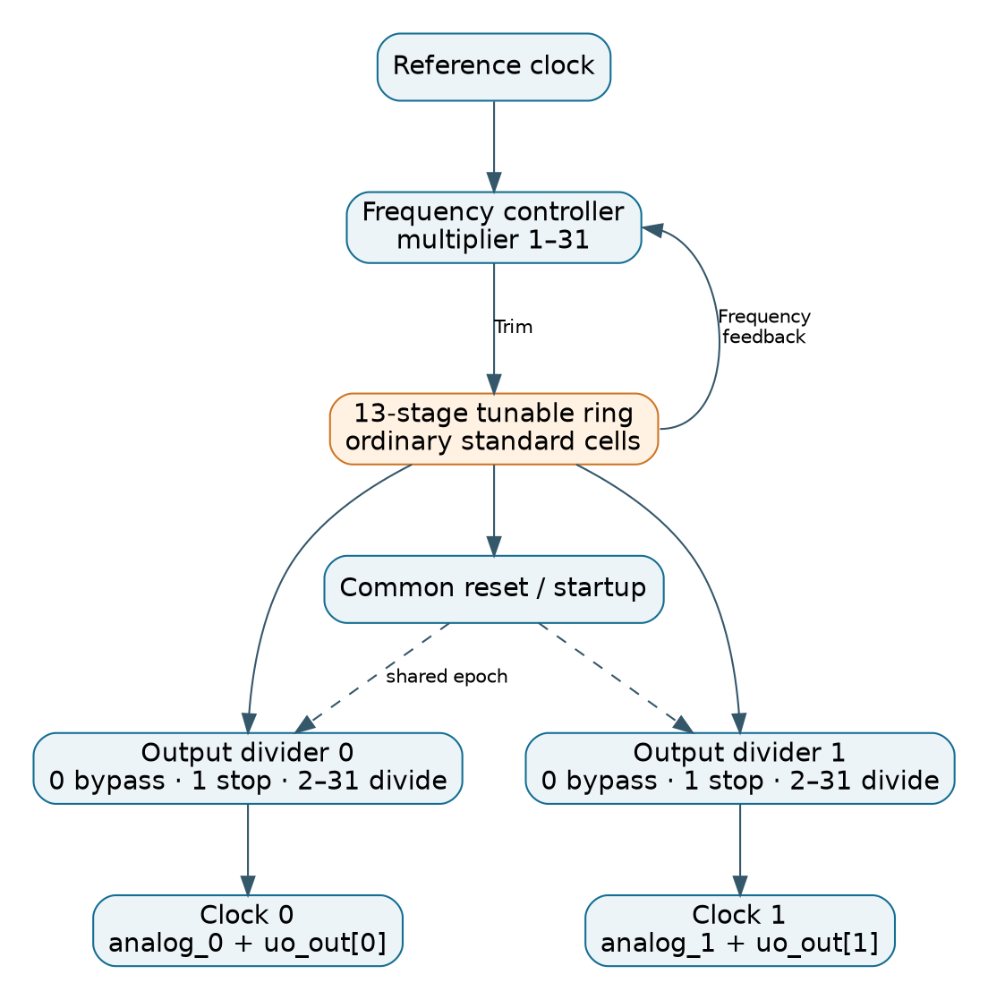
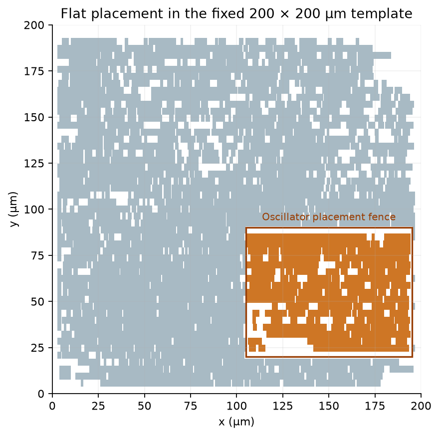
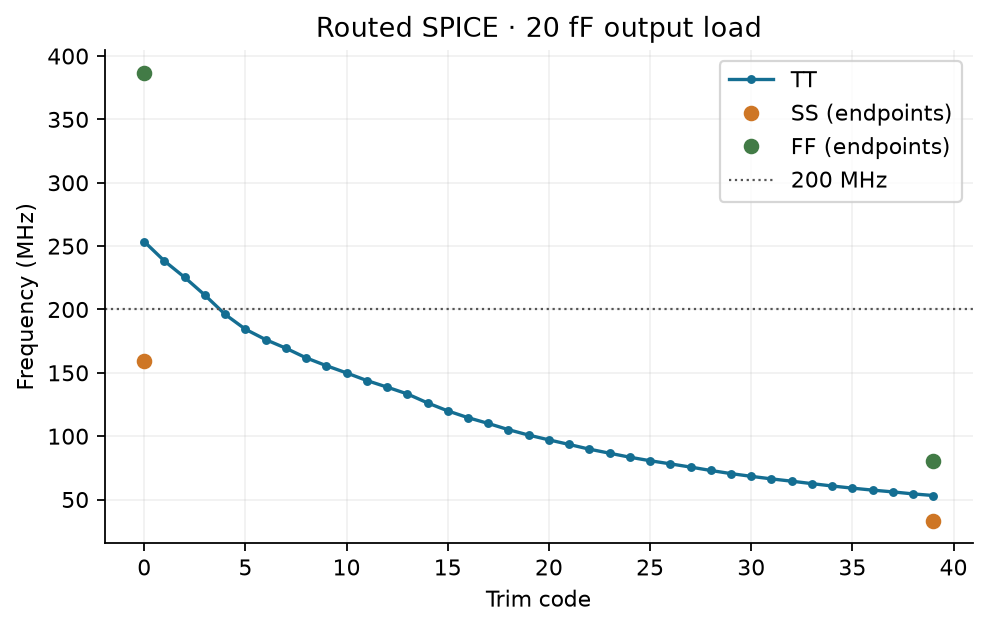
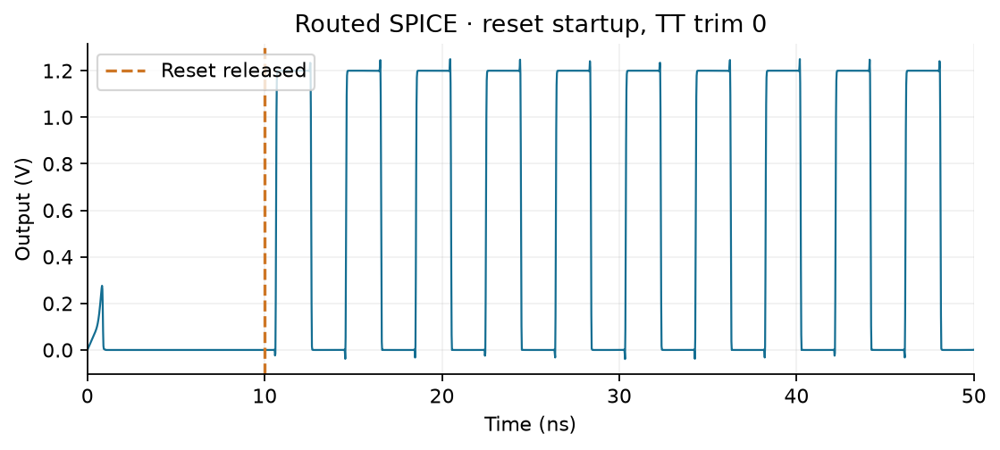
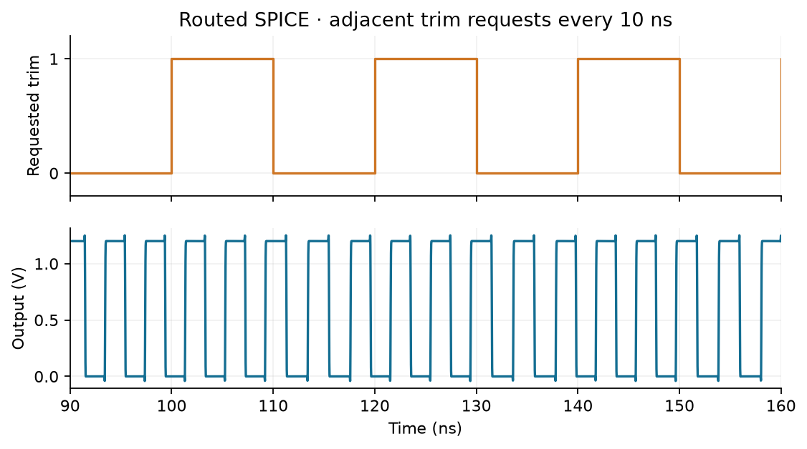
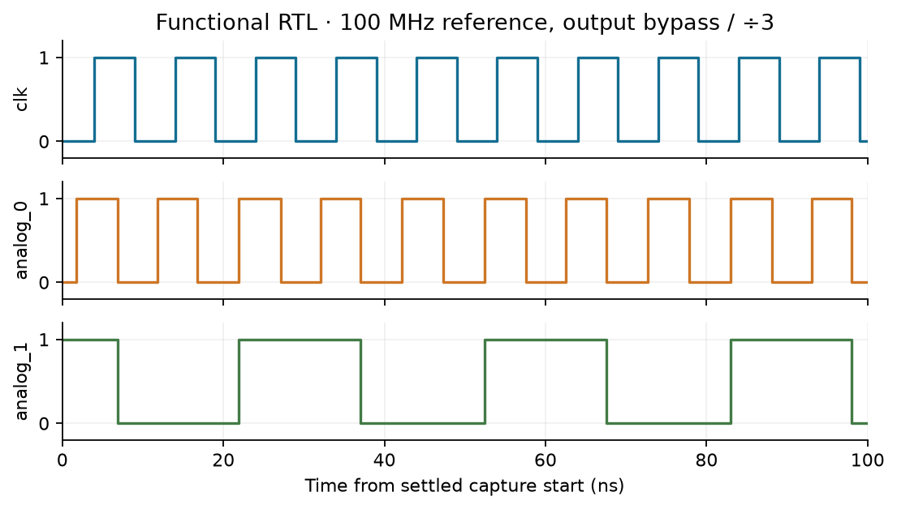
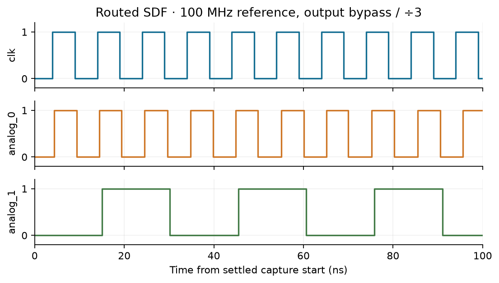

# Small multimode DLL

A single tunable ring oscillator feeds two independent integer dividers.
An FLL adjusts the oscillator's average frequency from one external reference.
For normal output division codes (2–31), the target and average frequencies are:

```text
target_f_ring = f_reference × multiply
f_clk0 = f_ring / divide0
f_clk1 = f_ring / divide1
```

The FLL regulates average frequency with finite resolution. The target must lie within the oscillator's physical tuning range. A shared
source and common divider startup epoch make the two output clocks phase-related;
the design does not lock their phase to the input clock. Unequal divisors give a
repeating edge relationship, rather than a constant phase angle between different
frequencies. Routing and cell delays introduce output skew.

The implementation uses ordinary **SG13CMOS5L standard cells only**: buffers,
inverters, logic gates, flip-flops and physical support cells. **No tri-state or
dedicated delay-gate cells are permitted.** There is no global input divider,
manual DCO port, phase selector, XOR mode, serial register, external clock-source selector, BusKit or
external oscillator tap bus.



## Parallel configuration and ports

The top is [heichips26_multimode_dll_small.sv](rtl/heichips26_multimode_dll_small.sv).
It retains the fixed tiny analog template's interface. Fifteen configuration
bits are packed as `{uio_in[6:0], ui_in[7:0]}`:

| Input | Meaning |
| --- | --- |
| `clk` | Reference clock; no input divider |
| `rst_n` | Active-low reset |
| `ena` | Active-high oscillator/controller enable |
| `ui_in[4:0]` | Global multiplier, 1–31; 0 is invalid and never asserts lock |
| `{uio_in[1:0], ui_in[7:5]}` | Clock 0 divisor |
| `uio_in[6:2]` | Clock 1 divisor |
| `uio_in[7]` | Reserved, ignored |

Each divisor uses **0 = bypass, 1 = stopped, 2–31 = divide by N**.
Odd divisors extend the high pulse by half a source period for approximately
50% duty cycle. Configuration is sampled while the counters are held reset;
it is not an atomic interface for live asynchronous updates.

| Output | Meaning |
| --- | --- |
| `uo_out[0]`, `analog_0` | Clock 0 through separate physical output buffers |
| `uo_out[1]`, `analog_1` | Clock 1 through separate physical output buffers |
| `uo_out[2]` | FLL lock status, asynchronous to the receiving fabric |
| `uo_out[7:3]`, `uio_out`, `uio_oe`, `analog_2` | Constant zero |

The fabric connection uses the template buses. `uio_oe` is explicitly zero;
this design does not enable a bidirectional output path. The third analog
port remains in the template but carries no clock.

For example, set `ui_in=8'h42` and `uio_in=8'h0c` while reset is asserted
for multiplier 2, clock-0 divisor 2 and clock-1 divisor 3. With a 100 MHz
reference, the targets are 100 MHz and 66.667 MHz, provided the oscillator
can reach 200 MHz at the operating corner.

### Startup and reconfiguration

1. Assert `rst_n=0` or hold `ena=0` and set all configuration bits.
2. Run the reference clock, release reset and assert enable.
3. Both divider counters start after a common sequence of eight falling
   oscillator edges. Allow the FLL to settle and synchronize `uo_out[2]` before
   using it in another clock domain.
4. Change configuration only while reset or disable is asserted, then restart.

Reset/disable can truncate an output pulse. Reference loss clears lock after
4096 oscillator cycles; it does not immediately stop the oscillator. Multiplier
or reference requests beyond the tuning range cannot produce the requested
frequency. Lock has a finite tolerance, so leave margin from the tuning endpoints.

## Circuit and physical implementation

[cell_map.v](rtl/cell_map.v) contains all explicit PDK cell instances. The rest
of the RTL uses its wrappers, retaining the chosen drive strengths and reset
polarities. Synchronizer attributes are attached to the underlying flip-flops.
The structure check rejects raw PDK cell instances outside this mapping file.

[ring_oscillator.v](rtl/ring_oscillator.v) contains thirteen explicit inverting
delay stages with four gate paths per stage. The 40 ordered trim settings change
one control wire at a time. Two local flip-flop ranks apply each trim bit on the
stage's delayed falling edge. Only one ring node reaches the isolated output
buffer. Intermediate internal nodes are part of the loop, not external taps.

[graded_fll_controller.v](rtl/graded_fll_controller.v) measures held ring-edge
counts over 128 reference cycles using request/return synchronizers. It applies
fractional tuning between adjacent trim levels. This controls average frequency;
individual periods can vary during tuning. Lock has finite count resolution and
does not certify jitter or phase accuracy.

[output_divider.v](rtl/output_divider.v) has explicit clock-buffer branches for
its sampling, configuration and counting registers. The two instances share
one startup epoch through separate reset-buffer branches. Each branch drives
seven counter flip-flops and one output gate. Matched inverter pairs retain one rising and one falling
inverter delay on each output edge.

The **200 × 200 µm** die and all **46 template pin shapes** are fixed. The
[DEF template](flow/librelane/heichips26_template_tiny_analog.def) is preserved
byte-for-byte. The oscillator occupies the **(105, 20)–(195, 90) µm** placement
region. This is a cell-placement fence, with no nested macro or routing
obstruction. The complete design uses routing through Metal4 and the normal
Metal3/Metal4 power grid.



The flow preserves **328 explicit clock/reset cells and their connections**.
Only the isolated reference and ring clocks feeding the controller receive
automatic clock trees. The SDC applies a **100 MHz reference / 400 MHz ring**
digital timing envelope, with **150 ps setup and 50 ps hold uncertainty**.
STA and SDF use **6 fF at each output port**. Chip-level pad and board loading
are outside this block-level timing check.
The physical feedback loop is cut for STA only. The transistor/SDF circuits keep
it closed. CDC exceptions end at first-stage sampling pins; the held count bus
has an explicit delay bound. The common divider
reset release is timed from its falling-edge source register to the counters.
Reset and enable remain electrically active in the SDC, so the backend repairs
their fanout and loading. A separate three-corner STA audit removes reset case
constraints and checks fanout, capacitance and slew. Reset/startup behavior and
static configuration assumptions are also checked in simulation.

## Verification report

The physical run `CELLMAP_20261104_1038` fits the fixed footprint, with
**30,415 µm²** of standard-cell area and about **83% utilization**.

All physical and simulation results below use this run.

| Check | Result |
| --- | --- |
| Routing/Magic/KLayout DRC, LVS and antenna checks | Zero reported violations |
| Fanout, transition and capacitance | Zero violations at all three corners, including an independent reset-switching audit |
| Minimum setup / hold slack | +0.228 ns / +0.073 ns |
| Fixed template geometry, oscillator region and power-pin connectivity | Pass |
| Explicit clock/reset cells | 328 preserved without resizing or rewiring |
| Cell restrictions | No tri-state or dedicated delay-gate cells in the reference or routed netlist |
| RTL divider pairs | All 1,024 pairs at both 100 and 400 MHz pass |
| RTL FLL/output behavior | All seven frequency/phase cases and reset, enable and reference-loss recovery checks pass with the measured frequency table |
| Routed SDF at TT | All seven frequency/phase cases, reset/enable, reference-loss recovery and waveform checks pass |
| Static transistor characterization | All 40 TT trim settings and both PVT endpoints pass; six cell-only endpoints and all six routed endpoints at half the time step also pass |
| Live trim at TT | All 12 directed cases pass at 10 ns and 100 ns update intervals |
| Verification coverage and source freshness | Pass |
| Submission precheck | All 13 stages pass |

The functional oscillator table uses all 40 measured nominal trim settings.
The calibrated RTL regression passes. This frequency model does not establish
transistor-level behavior of the complete FLL.

### Oscillator SPICE results

The routed nominal sweep passes all **40 ordered trim settings**, with a
monotonic range of **53.20–253.57 MHz**. The endpoint sweeps also pass at the
slow and fast process/voltage/temperature corners. The 200 MHz nominal target
is reached with the extracted signal parasitics included.

| Corner | Conditions | Cell-only endpoints | Routed endpoints |
| --- | --- | --- | --- |
| TT | 1.20 V, 25°C | 86.96–465.45 MHz | 53.20–253.57 MHz |
| SS | 1.08 V, 125°C | 55.21–296.59 MHz | 33.40–159.00 MHz |
| FF | 1.32 V, −40°C | 129.09–695.37 MHz | 80.69–386.94 MHz |

The cell-only fixture omits routing capacitance and resistance. Use the routed
range for this layout. The nominal duty cycle spans **48.90–50.23%** across
the 40 settings. The SS/FF checks cover the two endpoints; they are not full
40-code sweeps. A target above 200 MHz is supported at nominal conditions,
not across all three corners.

Halving the transient time step at all six PVT endpoints changes frequency
by at most **0.463%**, duty cycle by **0.010 percentage points** and minimum
pulse width by **0.450%**. All comparisons pass the configured numerical limits.



All checked corners start after the external reset is released, with no forced
internal initial condition. The startup plot shows a brief supply-ramp transient, a low output while
reset is held after the supply settles, and oscillation after reset release.



All **12 directed live-trim tests at TT pass**. They switch six adjacent code
pairs at 10 ns and 100 ns intervals and check pulse widths and periods against
the corresponding static settings. The plot below shows requests between codes
0 and 1 every 10 ns. In this case, periods remain between **3.939 and 4.197 ns**,
with a minimum pulse width of **1.965 ns**.



### RTL and routed gate-level results



The routed SDF measurements below use the full standard-cell netlist and routed
parasitics at **TT, 1.20 V, 25°C**. Frequencies are in MHz; “bypass” is divisor code 0 and “stop” is code 1.

| Reference | Multiplier | Divisors 0 / 1 | Target outputs | Measured outputs |
| --- | --- | --- | --- | --- |
| 100 | 1 | bypass / 3 | 100 / 33.333 | 98.55 / 32.85 |
| 100 | 2 | 2 / 3 | 100 / 66.667 | 99.27 / 66.18 |
| 20 | 11 | 3 / 5 | 73.333 / 44 | 73.12 / 43.88 |
| 10 | 24 | 5 / 5 | 48 / 48 | 47.86 / 47.86 |
| 5 | 31 | 31 / 7 | 5 / 22.143 | 4.98 / 22.08 |
| 10 | 20 | stop / 2 | 0 / 100 | 0 / 99.75 |
| 20 | 10 | 2 / 2 | 100 / 100 | 99.65 / 99.65 |



### Measurement scopes

- RTL and all-cell SDF: wait for lock, wait **10 µs**, then measure for **100 µs**.
  Acquisition is limited to **20 ms** per case, and the global simulation watchdog
  is **150 ms**. Frequency tolerance is 2%; periodic common rising edges are
  checked within 0.5 ns for two divided outputs, or 1 ns when one output bypasses
  its divider. Bypass omits the flip-flop delay. The observed SDF skew was 0.598 ns
  for bypass versus ÷3, and at most 0.074 ns for two divided outputs. Runt pulses
  and disagreement between fabric and analog outputs also fail the test. Every
  output rising edge is checked against the common oscillator-cycle epoch; skipped
  or duplicated source cycles fail immediately. The extracted controller timing
  check is separate from Icarus, which does not implement every library timing check.
- SPICE: the actual cell transistors use OpenVAF/OSDI models, a **1 ns supply ramp**,
  reset release at **10–10.05 ns**, **80 ns warmup** and a **90–290 ns** measurement
  window. No internal node is initialized to force startup. The output load is
  **20 fF**. Static checks cover startup, amplitude, duty, settling and monotonic trim.
- Routed SPICE retains oscillator cells and signal RC from the full layout.
  All three transistor corners use the same nominal extracted signal RC.
  Its supply rails are ideal; surrounding digital logic and crosstalk are omitted.
  `rshunt=1e12` supplies a global numerical DC path. This fixture is not a complete
  closed-loop transistor simulation of the FLL and dividers.
- Live trim at TT tests the adjacent pairs **0↔1, 12↔13, 13↔14, 25↔26, 26↔27
  and 38↔39**, with 50 ps control edges and 10/100 ns update intervals.
  These traces use second-order Gear integration and a maximum 10 ps step. Pulse/period limits are checked against the corresponding static
  settings. Not every possible asynchronous request instant or mismatch condition
  is covered.

## Build and reproduce

From the repository root:

```sh
source /path/to/oss-cad-suite/environment
source ./env.sh
make clone-pdk
make build-top BUILD_TAG=my_run
make librelane-openroad
```

`PDK_ROOT` may point to an existing SG13CMOS5L installation. There are no sibling
project dependencies. The backend wrapper also supports the OSS CAD Suite
LibreLane launcher and sanitizes incompatible Python/Verilator environment
variables before entering that runtime.

The reported run uses LibreLane **3.1.0.dev4** through the OSS CAD Suite
launcher, OpenSTA **2.7.0**, ngspice **42**, and IHP-Open-PDK commit
`1ffc783ff62e739856ee1b25e835338388c66c9e` (the revision pinned by the root
Makefile). The repository's Nix environment was not exercised for these results.

Run checks from this design directory. Select a Python with NumPy and an
OSDI-enabled ngspice once, so every simulation target inherits the same tools:

```sh
export SIM_PYTHON=/path/to/python-with-numpy
export NGSPICE=/path/to/ngspice
make test-measurements RUN_TAG=my_run
make sim-gl-verilog RUN_TAG=my_run
make sim-spice-ring sim-spice-routed RUN_TAG=my_run JOBS=4
make sim-spice-fine RUN_TAG=my_run
make sim-spice-transitions RUN_TAG=my_run JOBS=4
make update-frequency-model RUN_TAG=my_run
make sim-divider-verilog RUN_TAG=my_run
make sim-rtl-verilog RUN_TAG=my_run
make check-structure check-physical check-qualification publish-manifest RUN_TAG=my_run
```

The schematic target checks the six PVT endpoints with a maximum 10 ps step.
The routed target checks all 40 TT levels and both endpoints at SS/FF with a
maximum 20 ps step at TT/SS and 10 ps at FF. The routed sweep supplies the
functional frequency model.
The fine-step target repeats all six routed PVT endpoints at half each corner's
normal step (10 ps TT/SS, 5 ps FF)
and compares frequency, duty cycle and minimum pulse width. The numerical
limits are 1% frequency difference, 0.2 percentage points of duty cycle and
1% minimum-pulse difference. These checks bound simulation-step sensitivity;
they do not establish silicon accuracy or account for device mismatch.
Use `SPICE_ARGS='--full-pvt'` for all 120 schematic or routed combinations.
`SPICE_ARGS='--no-extract'` reuses the selected run's existing extracted fixture.
The optional quarter-step diagnostic can target one endpoint:

```sh
make sim-spice-finer RUN_TAG=my_run SPICE_ARGS='--trim 39 --corners tt --case-timeout-s 7200'
```

It writes a separate `routed_finer/` directory and does not replace the normal
or fine sweep. The extra 10-to-5 ps TT comparison uses a 0.2% frequency limit.

All testbench sources and sweep settings are under `testbenches/`; Python helpers
compile/generate them and analyze the saved results.

For digital simulation, override global times in nanoseconds:

```sh
make sim-gl-verilog RUN_TAG=my_run   VERILOG_ARGS='--warmup-ns 10000 --measure-ns 100000 --acquire-timeout-ns 20000000 --watchdog-ns 150000000'
```

`make verify BUILD_TAG=my_run` builds and runs the verification suites. For an
existing build, run `make sim-all RUN_TAG=my_run`, then
`make check-qualification publish-manifest RUN_TAG=my_run`.
`build-top` performs physical checks and publishes views without automatically
running long simulations. `RUN_TAG` selects existing results; it defaults to the
latest successful physical build. `BUILD_TAG` creates a new physical run.
GUI targets open that latest successful physical run.

### Waveforms, figures and generated files

ngspice saves `test.sp`, `ngspice.log`, `waveform.dat` and `measurements.json`
for each case. `waveform.dat` contains time in seconds and output voltage.
SDF generation logs, physical SDF, Icarus-compatible copies and simulation logs
are under `build/<tag>/simulation/verilog/gl/`.

```sh
make capture-waveforms RUN_TAG=my_run
make report-images RUN_TAG=my_run REPORT_PYTHON=/path/to/python-with-matplotlib
# Review build/my_run/documentation/img/, then publish the curated figures:
make publish-report RUN_TAG=my_run REPORT_PYTHON=/path/to/python-with-matplotlib
```

The generator writes diagrams and plots to the ignored run directory. Publication
copies the reviewed files to `img/` beside this README and records input/output
hashes. It does not change RTL or layout files.

To inspect waveforms interactively:

```sh
gtkwave build/my_run/simulation/verilog/gl_wave/waveform.vcd
env -u PYTHONHOME -u PYTHONPATH -u PYTHONEXECUTABLE -u __PYVENV_LAUNCHER__ \
  /path/to/python-with-matplotlib scripts/view_waveform.py \
  build/my_run/simulation/ngspice/routed/tt_trim00/waveform.dat --start-ns 0 --stop-ns 50
```

The Python viewer requires NumPy and Matplotlib. Use `--save build/my_run/trace.png`
when running without a graphical display.

| Directory | Ownership |
| --- | --- |
| `rtl/` | Complete physical RTL; no nested macro sources |
| `flow/librelane/` | YAML, SDC and the fixed tiny analog DEF |
| `scripts/` | Build, simulation, extraction and checking helpers |
| `testbenches/verilog/` | Digital testbench and functional frequency fixture |
| `testbenches/ngspice/` | Sweep values and OpenVAF model startup template |
| `build/<tag>/` | Ignored runs, reports, extracted netlists and waveforms |
| `img/` | Curated documentation figures |
| `final/` | Versioned GDS, LEF, netlists, Liberty, SPEF and manifest |

`make clean` removes only the design's ignored `build/` tree. `clean-sim` removes
only the selected run's simulations. Neither removes source or published views.
